# Product Reliability & Developer Ecosystem Intelligence

**An open-source health scorecard for 30 widely used Python data and ML libraries.**
It answers one question: *which of the projects my product depends on are getting riskier, and how do I know?*

[](https://public.tableau.com/app/profile/ubed.m.a5650/viz/ProductReliabilityDeveloperEcosystemIntelligence)
[](LICENSE)

**Live dashboard:** <https://public.tableau.com/app/profile/ubed.m.a5650/viz/ProductReliabilityDeveloperEcosystemIntelligence>

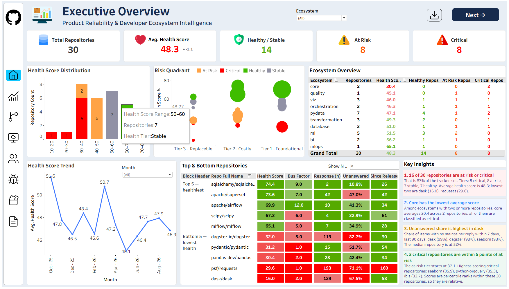

---

## Contents

1. [The problem](#1-the-problem)
2. [What the project delivers](#2-what-the-project-delivers)
3. [Architecture](#3-architecture)
4. [Data sources and why there are several](#4-data-sources-and-why-there-are-several)
5. [Data model and lineage](#5-data-model-and-lineage)
6. [The metrics](#6-the-metrics)
7. [The health score](#7-the-health-score)
8. [The dashboard](#8-the-dashboard)
9. [How I checked the work](#9-how-i-checked-the-work)
10. [Key findings](#10-key-findings)
11. [Design decisions](#11-design-decisions)
12. [Limitations](#12-limitations)
13. [Run it yourself](#13-run-it-yourself)
14. [Repository layout](#14-repository-layout)
15. [Roadmap](#15-roadmap)

---

## 1. The problem

Every product built on open source inherits the risk of its dependencies. A library can look fine (many stars, recent release) while the people behind it quietly thin out: one maintainer merges nearly everything, issues wait weeks for an answer, newcomers do not come back.

Stars and download counts do not show this. This project measures **maintenance health** directly from how work actually flows through each repository: who merges, how fast people get answers, whether bugs pile up, whether new contributors stay.

The audience is a product, platform or engineering-management team deciding which dependencies deserve attention, funding or a contingency plan.

## 2. What the project delivers

| Deliverable | Where |
|---|---|
| A reproducible pipeline from raw GitHub data to analytics marts | `scripts/`, `models/` |
| A 0–100 health score per repository, monthly and current | `fct_health_score_monthly`, `fct_repo_health_current` |
| A multi-page Tableau Public dashboard | link above |
| A Google Sheet serving layer that refreshes the dashboard | `scripts/to_sheets.py` |
| Validation: sensitivity analysis, backtest, source-fidelity check | `docs/` |
| Written decisions and metric definitions | `docs/decisions/`, `docs/metrics.md` |

## 3. Architecture

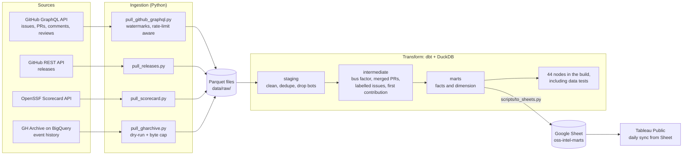

**Why this shape**

- **Parquet between ingestion and transformation.** Ingestion can be re-run or fixed without touching models, and the warehouse is rebuildable from files.
- **dbt + DuckDB.** Real SQL models, tests and lineage with no server to run. The whole warehouse is one file.
- **Google Sheets in the middle.** Tableau Public cannot hold a live database connection. Google Sheets is the one source it re-syncs automatically (every 24 hours), so the Sheet is the free-tier refresh path, not a workaround. Only small aggregates go up, never raw events.

## 4. Data sources and why there are several

| Source | Used for | Notes |
|---|---|---|
| **GitHub GraphQL** | Issues, pull requests, authors, labels, first maintainer response, contribution records | Primary source for every metric. Per-repo watermarks make runs resumable inside the 5,000-point hourly limit. |
| **GitHub REST** | Releases | Drafts and pre-releases are excluded. |
| **OpenSSF Scorecard (REST)** | Supply-chain security context (`scorecard_overall`, `check_maintained`) | Available for 26 of 30 repositories. Context only, not part of the score. |
| **GH Archive via BigQuery** | Pre-2026 history for the backtest; source-fidelity comparison | Queries are dry-run first and capped with `maximum_bytes_billed`. |

I started with GH Archive alone and had to change course. Two things broke that plan, both documented as decision records:

1. **GitHub changed the Events API payloads** (scheduled for 7 Oct 2025, per GitHub's changelog), removing fields such as commit lists and author association. GH Archive mirrors that API. → [ADR 0001](docs/decisions/0001-two-source-architecture.md)
2. **GH Archive fidelity collapsed in 2026.** Measured against the API, the archive's coverage fell by about 95%. → [ADR 0002](docs/decisions/0002-gharchive-fidelity.md)

So metrics come from the GraphQL API, and GH Archive is kept only where it still is reliable, and as evidence for the fidelity page.

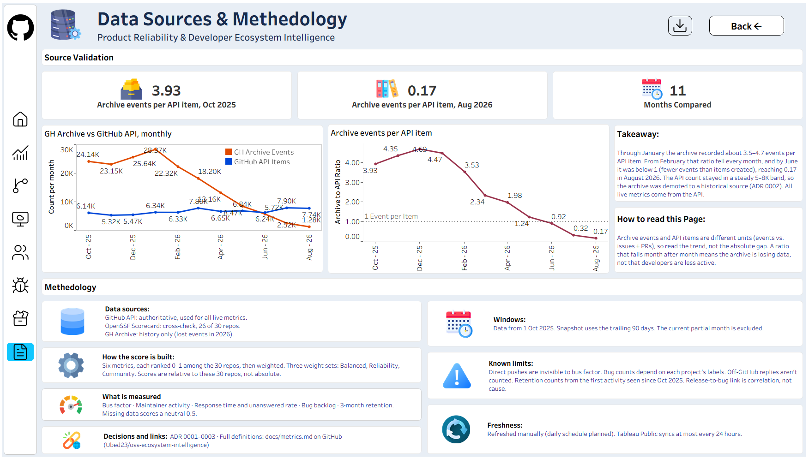

## 5. Data model and lineage

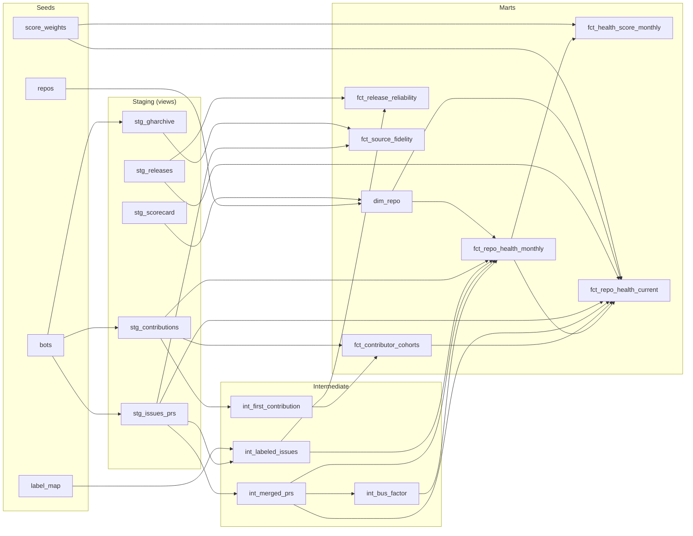

**Grain of each mart**

| Model | One row per | Purpose |
|---|---|---|
| `dim_repo` | repository | Names, ecosystem, criticality tier, Scorecard context |
| `fct_repo_health_monthly` | repository × month | All monthly raw metrics |
| `fct_health_score_monthly` | repository × month | Score history and 6-month change |
| `fct_repo_health_current` | repository | Latest snapshot, score and tier |
| `fct_contributor_cohorts` | repository × cohort month × months since | Retention triangle |
| `fct_release_reliability` | release | Bugs after vs. expected |
| `fct_source_fidelity` | month | GH Archive events vs. API items |

## 6. The metrics

Full definitions, null handling and caveats are in [`docs/metrics.md`](docs/metrics.md). In short:

| Metric | Definition | In score |
|---|---|---|
| **Bus factor** | Fewest authors whose merged PRs make up at least 50% of merged PRs | Yes |
| **Maintainer activity** | Distinct merged-PR authors, trailing 90 days | Yes |
| **Response time** | Time to first comment or review by an owner, member or collaborator who is not the author | Yes |
| **Unanswered share** | Share of items with no maintainer response inside a 7-day SLA | Yes |
| **Bug backlog** | Open bug issues at month end (labels normalised through `label_map`) | Yes |
| **Contributor retention** | Share of a first-time-contributor cohort active again in month 3 (pooled, used only when the sample is at least 100 people) | Yes |
| **Post-release regression ratio** | Bugs in the 14 days after a release vs. the 90-day baseline; judged only when at least 2 were expected and the window is complete | No (release page) |
| **Release cadence** | Median gap between releases, days since last release | No (context) |

Details worth knowing:

- Bots are removed at source (`seeds/bots.csv` plus a login heuristic).
- A contribution is **work**: opening an issue or PR, commenting, or reviewing. Stars and forks are interest, not work, and are excluded.
- Retention is a left-truncated cohort triangle that measures *activity in month N*, not survival. The current partial month is excluded.

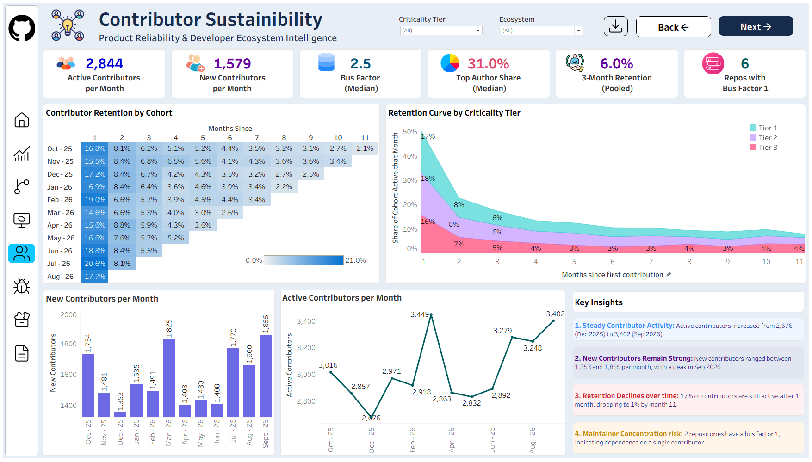

## 7. The health score

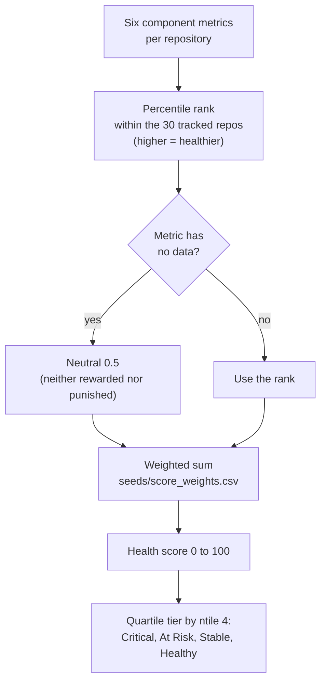

Design choices, each deliberate:

- **Percentile rank, not absolute thresholds.** There is no universal "good" bus factor for a data library. Ranking says how a project compares with its peers.
- **Neutral 0.5 for missing data.** A repo with no bugs filed, or too small a cohort for retention, is not penalised for having nothing to measure.
- **Three weight schemes live in a seed file** so weighting is configuration, not code, and can be stress-tested (next section).
- **Tiers are quartiles**, so by construction the split is always about 8 / 8 / 7 / 7. A tier is a *relative* label. It does not mean a quarter of projects are objectively failing.

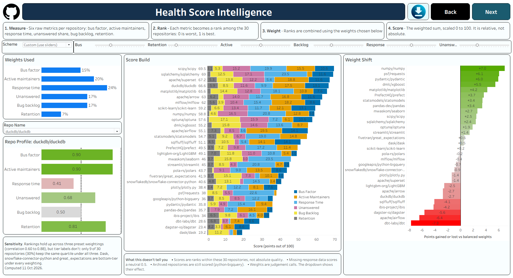

*Current health score and tier per repository, with the 6-month change. Tiers are quartile-based, so read them as relative standing.*

## 8. The dashboard

Built in Tableau Public from the Google Sheet. Fixed-size pages, consistent navigation, and a Data Sources & Methodology page inside the workbook itself.

| Page | Question it answers | Screenshot |
|---|---|---|
| Executive Overview | Where does each repo stand, and who is moving? | `docs/images/01-executive-overview.png` |
| Health Score | How does each repo score, and how has it moved over 6 months? | `docs/images/08-health-score.png` |
| Maintainer & Risk | Where is maintainership concentrated? | `docs/images/02-maintainer-risk.png` |
| Engineering Operations | How work flows through each repo? | `docs/images/09-engineering-operations.png`|
| Bug Backlog | Which projects are accumulating open bugs? | `docs/images/03-bug-backlog.png` |
| Contributor Sustainability | Do new contributors stay? | `docs/images/04-contributor-sustainability.png` |
| Release Reliability | Do releases precede a bug spike? | `docs/images/05-release-reliability.png` |
| Data Source Validation | Can the underlying data be trusted? | `docs/images/06-source-fidelity.png` |
| Data Sources & Methodology | How is everything computed and what are the caveats? | `docs/images/07-methodology.png` |

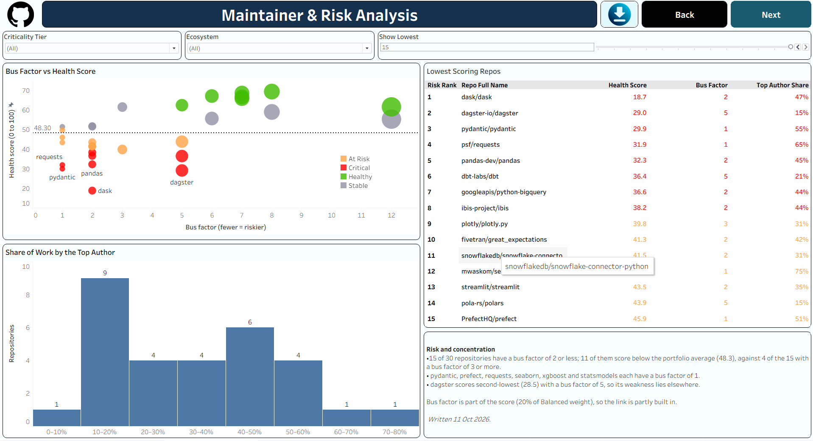

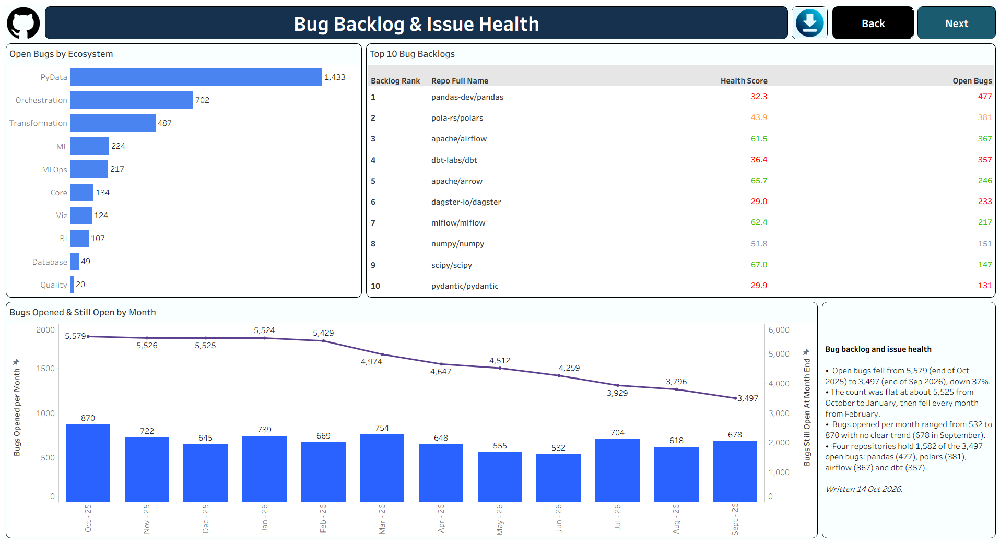

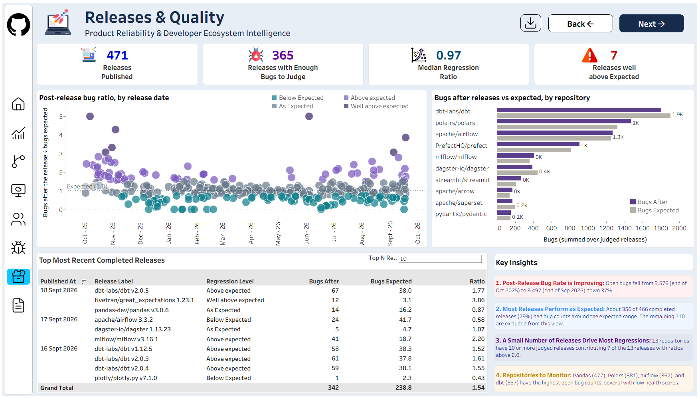


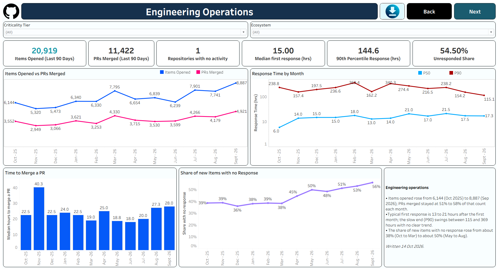

## 9. How I checked the work

A composite score invites the objection "your weights are arbitrary". Instead of defending the weights I tested them.

### 9.1 Sensitivity analysis (`scripts/sensitivity_analysis.py`)

The score is recomputed under all three weight schemes. Results from the current build:

| Check | Result |
|---|---|
| Spearman rank correlation between the schemes | 0.884, 0.857 and 0.572 (one pair per scheme comparison) |
| Repos keeping the same quartile tier under all three | **27%** |
| Critical under **every** weighting | **dask** and **pydantic** |

**Reading:** rankings broadly agree, but tier labels near the cut-offs are fragile. That is why the dashboard presents the score as one input and calls out only the findings that survive every weighting. Full output: [`docs/sensitivity_summary.md`](docs/sensitivity_summary.md).

### 9.2 Backtest (`scripts/backtest.py`, [`docs/backtest_summary.md`](docs/backtest_summary.md))

Using only data up to 2024-12-31, flag repositories with deteriorating activity, then see which were later abandoned.

| | |
|---|---|
| Repositories | 243 |
| Later died | 4 (1.6%) |
| Flagged | 61 (2 died, 59 survived) |
| Precision / recall | 3.3% / 50.0% |
| Lift vs. base rate | about 2x |
| Median lead time | 10.9 months |

This is a **proof of concept, not a predictor.** Four events is far too few to claim skill, the model is activity-only, and "death" is a proxy. It shows the signal points the right way and nothing more.

### 9.3 Source-fidelity check

Comparing GH Archive events with API items per month showed the archive-to-API ratio falling from about 3.9 to about 0.16, which is why GH Archive was demoted (ADR 0002).

### 9.4 Automated tests

`dbt build` runs **44 nodes with 0 failures** (seeds, models, and tests), including singular tests such as `assert_cohort_grid_valid`.

## 10. Key findings

> These are the statements that held up under the checks above. Anything that depended on a particular weighting is deliberately left out.

- **dask and pydantic rank in the bottom tier under every weighting** tested. They are the clearest candidates for a contingency conversation.
- **Maintainership is concentrated.** Several projects rely on a very small group for the majority of merged PRs (see Maintainer & Risk).
- **Retention is low everywhere.** Month-3 retention in the pooled cohorts is in the low single digits to roughly ten percent, so the score uses it as a *relative* signal.
- **Public event archives are not safe as a sole source.** The fidelity collapse and the 2025 payload change both silently corrupt metrics unless you measure the source against a second one.

## 11. Design decisions

| ADR | Decision |
|---|---|
| [0001](docs/decisions/0001-two-source-architecture.md) | Two sources: the API for authorship, merge, labels and responses; GH Archive for breadth and history |
| [0002](docs/decisions/0002-gharchive-fidelity.md) | Demote GH Archive after measured fidelity collapse |
| [0003](docs/decisions/0003-scorecard-source.md) | Read OpenSSF Scorecard through the REST API (26 of 30 repos covered) instead of scanning the BigQuery table (85 GB per scan) |

## 12. Limitations

I would rather state these than have a reviewer find them.

- **Size bias.** Larger, busier repositories look more concentrated and more loaded simply because they have more traffic.
- **Unanswered share** counts every item without a maintainer response in 7 days, including maintainer-authored and very recent items. It is a proxy.
- **Tiers are quartiles.** They always split roughly 8 / 8 / 7 / 7 and are not absolute judgements.
- **Percentile ranking stretches small differences.** Retention values of about 1–10% become a full 0–1 spread.
- **Comment truncation.** Only the first 10 comments and 5 reviews per item are fetched; a late first maintainer reply on a very long thread could be missed.
- **Retention is left-truncated** and measures activity, not survival.
- **Bug counts** use label normalisation; an issue carrying two bug labels can be counted twice (measured at about 1.85%).
- **Direct pushes are invisible.** Work committed without a PR is not seen.
- **Refresh is manual today.** Run `dbt build` and `to_sheets.py`; a scheduled job is on the roadmap.
- **Public data only.** No internal incident, dependency-usage or revenue data.

## 13. Run it yourself

Requirements: Python 3.12, a GitHub token, optionally a Google Cloud project and service account.

```bash
git clone https://github.com/Ubed23/oss-ecosystem-intelligence.git
cd oss-ecosystem-intelligence

python -m venv .venv
# Windows PowerShell:  .\.venv\Scripts\Activate.ps1
# macOS/Linux:         source .venv/bin/activate
pip install -r requirements.txt

cp .env.example .env        # then fill in the values
mkdir warehouse             # git-ignored, must exist before dbt runs
```

**Build the warehouse from Parquet and run all tests**

```bash
dbt build --profiles-dir . --threads 1
```

On Windows, if numerical libraries misbehave, set `$env:OPENBLAS_NUM_THREADS="1"` first.

**Refresh data**

```bash
python scripts/pull_github_graphql.py --since 2025-10-01   # backfill, resumable
python scripts/pull_github_graphql.py                      # daily increment
python scripts/pull_releases.py
python scripts/pull_scorecard.py
```

**Validate**

```bash
python scripts/sensitivity_analysis.py
```

**Publish to the Sheet that feeds Tableau**

```bash
python scripts/to_sheets.py --dry-run
python scripts/to_sheets.py
```

Share the Sheet with the service account's `client_email` as Editor, or you will get an error that looks like authentication but is permissions.

**Secrets:** `.env` and `service_account.json` are git-ignored. Never commit them.

## 14. Repository layout

```
.
├── README.md
├── LICENSE
├── .env.example
├── dbt_project.yml / profiles.yml
├── requirements.txt
├── seeds/                  repos, bots, label_map, score_weights
├── models/
│   ├── staging/            stg_*   (clean, dedupe, drop bots)
│   ├── intermediate/       int_*   (bus factor, merged PRs, labelled issues, first contribution)
│   └── marts/              dim_repo, fct_*   (what Tableau reads)
├── tests/                  singular data tests
├── scripts/                ingestion, backtest, sensitivity, to_sheets
├── docs/
│   ├── metrics.md          every definition and caveat
│   ├── backtest_summary.md
│   ├── sensitivity_summary.md
│   ├── decisions/          ADRs
│   └── images/             dashboard screenshots
├── data/raw/               Parquet (git-ignored)
├── warehouse/              DuckDB file (git-ignored)
└── .github/workflows/      pipeline-check
```

## 15. Roadmap: future development

Grouped by theme and ordered roughly by value for effort. Nothing below is built yet; the status column says so plainly.

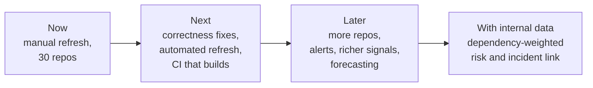

### 15.1 Next: correctness and reliability

| Item | Why it matters |
|---|---|
| Count each bug once (`count(distinct number)`) | Removes the ~1.85% double count of dual-labelled issues |
| Narrow unanswered share to external, non-recent items | Stops maintainer-authored and brand-new items inflating the metric |
| Add an `as_of` variable instead of `current_timestamp` | A rebuild on another day reproduces the same numbers |
| Use full-month active contributors | The latest month is partial today |
| Check comment truncation (first 10 comments, 5 reviews) and paginate where needed | Avoids missing a late first maintainer reply |
| Save results per repo in the GraphQL pull, with try/except | One failure no longer loses a long run |
| Handle deleted ("ghost") authors explicitly | Currently dropped silently |
| Declare `sources.yml` for the raw Parquet files | Makes lineage and freshness checks complete |
| More tests: weights sum to 1, cohort grid uniqueness, score within 0–100 | Catches silent regressions like the one that hit `main` once |
| Remove debugging scripts and temporary CSVs from `docs/` | A cleaner repository |

### 15.2 Next: automation

- **Scheduled daily pipeline** in GitHub Actions: pull → `dbt build` → `to_sheets.py`, with the GitHub token and service account stored as repository secrets.
- **CI that runs `dbt build`** on every pull request, not only an import check, so a broken model cannot reach `main`.
- **Data freshness check** that fails loudly if the newest ingested date is older than a threshold.
- **Failure notification** (email or Slack) when a scheduled run fails or a data test fails.
- **Branch protection** on `main` so changes go through pull requests.

### 15.3 Later: scope and signals

| Idea | Value |
|---|---|
| Expand beyond 30 repositories (JavaScript, Rust, Go ecosystems) | Tests whether the score generalises |
| Size-normalised metrics (per active contributor, per 100 items) | Reduces the size bias listed in the limitations |
| Absolute thresholds beside percentile ranks | A tier that means something on its own, not just relative standing |
| Tier labels with hysteresis | Stops repositories flickering across a quartile boundary month to month |
| Richer signals: CI pass rate, time to merge, time to close, security-advisory response time, dependency freshness | A fuller picture of reliability |
| Add Scorecard checks (e.g. code review, branch protection) into the score once coverage improves | Joins security posture to maintenance health |
| Maintainer-succession view: who else is close to taking over the merge load | Turns bus factor from a number into an action |
| Separate funding and governance context (foundation backed, sponsors, company backed) | Explains *why* some projects stay healthy |
| Migrate the serving layer from Sheets to a warehouse (BigQuery or MotherDuck) with a BI tool that supports live connections | Removes the 24-hour sync and cell-count limits |

### 15.4 Later: analytics and modelling

- **Early-warning alerts:** notify when a repository drops a tier or its score falls by more than a set amount over 6 months.
- **Trend forecasting:** simple time-series projection of score and bus factor to estimate time-to-critical.
- **A stronger backtest:** more repositories and more failure events, a proper train/test split, and multiple abandonment definitions (archived, no release for 12+ months, maintainer announcement).
- **Survival-style retention analysis** (true survival curves instead of activity-in-month-N), with confidence intervals on small cohorts.
- **Uncertainty on the score:** bootstrap intervals so close rankings are shown as ties rather than false precision.
- **Release risk model:** test whether post-release regression ratio predicts later bug spikes beyond chance.
- **Text signals (experimental):** classify issue and discussion tone or "maintainer burnout" language from public threads.

### 15.5 Later: product and presentation

- Per-repository drill-down page (one repo, all metrics, history, peers).
- A "compare two libraries" view for dependency-choice decisions.
- Parameter controls so a viewer can set their own weights (the component scores are already published for this).
- A short public write-up of the method and findings.
- Exportable one-page risk brief per repository.

### 15.6 With internal data

This is where the project becomes decision-grade for a real product team:

- Join **dependency usage** (which services import which library, and how deeply) so risk is weighted by blast radius.
- Join **incident and bug history** to learn which upstream signals actually preceded your own outages.
- Add **contribution back** (patches your team sent upstream) and **fork or vendoring** status.
- Produce a **prioritised watch list** with owners and a recommended action: monitor, contribute, pin a version, or plan a migration.

## License

[MIT](LICENSE)